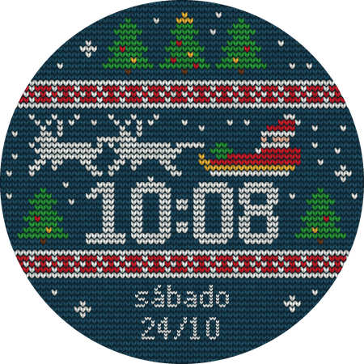
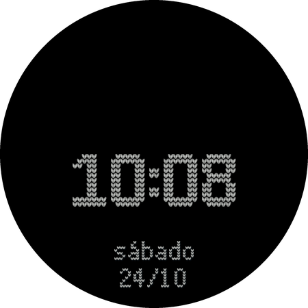

# Tricô de Natal — mostrador para Wear OS




Mostrador de relógio no formato **Watch Face Format (WFF)** para Wear OS: só XML e imagens, sem código Kotlin/Java.
Visual de "suéter de Natal" em tricô: renas, trenó do Papai Noel, árvores, faixas brancas e vermelhas,
hora grande em ponto de tricô e dia da semana/data em português do Brasil (independente do idioma do relógio).
No modo ambiente aparecem só a hora e a data, sobre fundo preto.

Testado em um Galaxy Watch 7 (SM-L310). Requer Wear OS 4 ou superior (API 34+).

## Instalação rápida (sem compilar)

Baixe o `trico-de-natal-v1.0.apk` na página de [Releases](../../releases) e siga a seção
[Instalar no relógio](#instalar-no-relógio). O APK é assinado com a chave de debug, adequado para instalação via adb.

## Compilar

Requisitos:
- JDK 17
- Android SDK com platform 35 e build-tools (ou Android Studio)
- Python 3 com `pillow` e `numpy` (apenas se for alterar a arte)

Informe o SDK em um arquivo `local.properties` na raiz do projeto:

```
sdk.dir=/caminho/para/Android/Sdk
```

(ou defina a variável de ambiente `ANDROID_HOME`). Depois, em Linux/macOS:

```
./gradlew :watchface:assembleDebug
```

No Windows:

```
gradlew.bat :watchface:assembleDebug
```

O APK sai em `watchface/build/outputs/apk/debug/watchface-debug.apk`.

## Instalar no relógio

Funciona em Galaxy Watch e em qualquer relógio com Wear OS 4+ (API 34+), por Wi-Fi.

1. No relógio: Configurações > Sobre o relógio > Software e toque 5 vezes em "Versão do software" para ativar o modo desenvolvedor.
2. Em Opções do desenvolvedor, ative "Depuração ADB" e "Depuração por Wi-Fi" (relógio e computador na mesma rede).
3. Em "Depuração por Wi-Fi", escolha parear com um novo dispositivo. O relógio mostra um código de 6 dígitos e um IP:porta de pareamento
   (essa porta é diferente da porta de conexão mostrada na tela principal da depuração por Wi-Fi):
   ```
   adb pair IP:PORTA_DE_PAREAMENTO CODIGO
   ```
4. Conecte usando o IP:porta da tela principal da depuração por Wi-Fi e instale:
   ```
   adb connect IP:PORTA
   adb install -r watchface-debug.apk
   ```
5. Pressione e segure o mostrador atual, toque em "Adicionar mostrador" e escolha "Tricô de Natal".
6. Depois de instalar, desative a depuração por Wi-Fi no relógio.

## Personalizar

Toda a arte e o XML são gerados por dois scripts:

- `ferramentas/gerar_arte.py` gera todos os PNGs (em `watchface/src/main/res/drawable-nodpi/`) e as prévias em `previa/`.
- `ferramentas/gerar_xml.py` gera `watchface/src/main/res/raw/watchface.xml`.

```
pip install pillow numpy
python ferramentas/gerar_arte.py
python ferramentas/gerar_xml.py
./gradlew :watchface:assembleDebug
```

Edite os scripts (cores, motivos, posições), rode-os e recompile.

## Nota técnica

O runtime de mostradores da Samsung ignorou o `BitmapFont` do WFF. Por isso os dígitos da hora e da data são
slots de imagem, escolhidos por expressões `Condition` no XML (daí o `gerar_xml.py`). O XML foi validado com o
validador oficial do Google (repositório google/watchface).

## Licença

MIT — veja [LICENSE](LICENSE).
